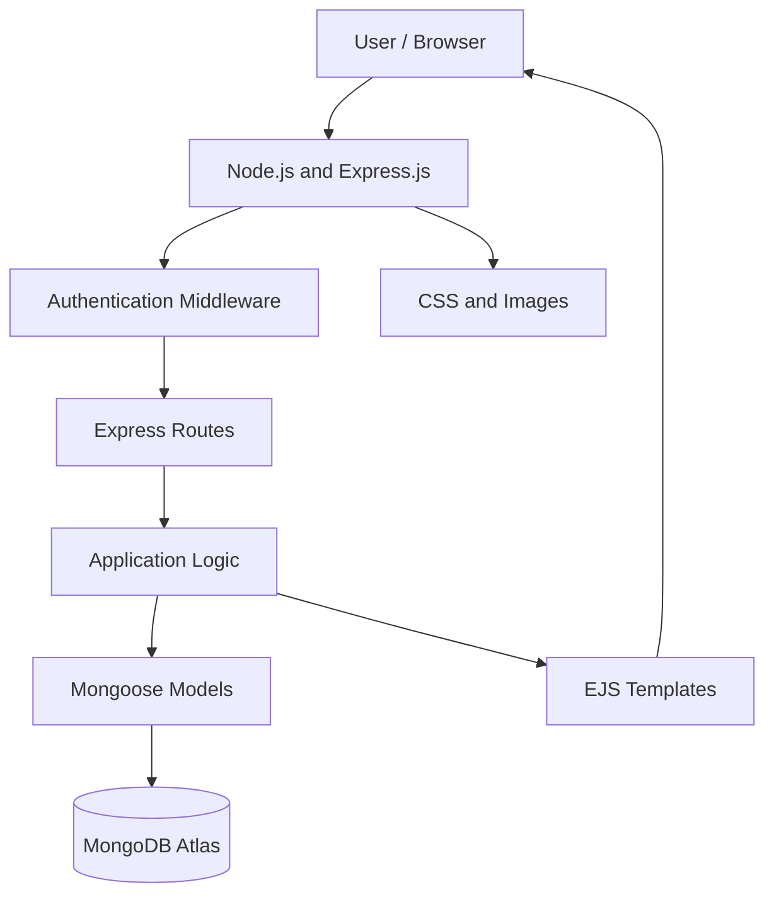

# 🏥 Hospital Management System

A full-stack Hospital Management System built using **MongoDB, Express.js, Node.js, and EJS**.

The application provides a web-based platform for managing hospital operations through server-rendered pages, backend routes, database models, and authentication middleware.

Unlike a traditional MERN application that uses React for its frontend, this project uses **EJS (Embedded JavaScript Templates)** for dynamic server-side rendering.

## ✨ Features

### 👨‍⚕️ Doctor Management
- Manage doctor information and profiles.
- View doctor details.
- Organize doctor-related information.

### 👥 User Management
- User registration and login.
- Role-based access to application functionality.
- Middleware-based request handling.

### 🏥 Hospital Operations
- Manage hospital-related information.
- Server-rendered dashboard and application pages.
- Dynamic views using EJS templates.

### 🖼️ File Management
- Image upload support.
- Static asset management.
- Organized storage for uploaded files.

### 🔐 Backend Architecture
- Express.js routing and middleware.
- MongoDB data persistence.
- Structured database models.
- Centralized application request handling.

## 🛠️ Technology Stack

| Category | Technologies |
|---|---|
| Language | JavaScript |
| Runtime | Node.js |
| Backend Framework | Express.js |
| Frontend Rendering | EJS |
| Database | MongoDB Atlas |
| Database Integration | Mongoose |
| Styling | CSS |
| Authentication | Application authentication middleware |
| Deployment | Render |

## 🏗️ Application Architecture



## 📁 Project Structure

```text
Hospital-Management-System/
│
├── images/              # Application images
├── middleware/          # Custom middleware
├── models/              # Database models
├── public/
│   └── css/             # Stylesheets
├── routes/              # Express application routes
├── uploads/             # Uploaded files
├── views/               # EJS templates
│
├── createAdmin.js       # Admin initialization
├── server.js            # Application entry point
├── package.json         # Dependencies and scripts
└── README.md
```

## ⚙️ Installation and Setup

### Prerequisites

- Node.js
- npm
- MongoDB Atlas account or local MongoDB instance
- Git

### 1. Clone the Repository

```bash
git clone https://github.com/Sandeep8217/Hospital-Management-Systems.git

cd Hospital-Management-Systems
```

### 2. Install Dependencies

```bash
npm install
```

### 3. Configure Environment Variables

Create a `.env` file in the project root and configure the required application settings.

Example:

```env
PORT=3000
MONGODB_URI=your_mongodb_connection_string
```

Add any additional environment variables required by your application.

Never commit database credentials or sensitive configuration to GitHub.

### 4. Start the Application

```bash
npm start
```

If your project does not define a start script, run:

```bash
node server.js
```

Open the application in your browser at:

```text
http://localhost:3000
```

The port may vary depending on your configuration.

## 🌐 Live Demo

[Visit Hospital Management System](https://hospital-management-systems-1-hxez.onrender.com)

## 🎯 Learning Outcomes

This project helped me gain practical experience in:

- Building full-stack applications using Node.js and Express.js.
- Implementing server-side rendering with EJS.
- Designing RESTful routes and backend middleware.
- Integrating MongoDB Atlas using Mongoose.
- Organizing applications using routes, models, and views.
- Handling file uploads and static assets.
- Deploying a Node.js application.

## 🚀 Future Improvements

- Enhance dashboard analytics and reporting.
- Improve appointment scheduling and management.
- Add advanced role-based access control.
- Improve validation and error handling.
- Add automated testing.
- Enhance responsive UI and user experience.

## 👨‍💻 Author

**Sandeep Karne**

Software Engineer | Java Backend Developer | Full Stack Developer

- GitHub: [Sandeep8217](https://github.com/Sandeep8217)
- LinkedIn: [Sandeep Karne](https://www.linkedin.com/in/sandeepkarne/)
- Portfolio: [Visit Portfolio](https://sandeep-portfolio.sandeepkarne126.workers.dev)

---

⭐ If you find this project interesting, consider giving it a star!
